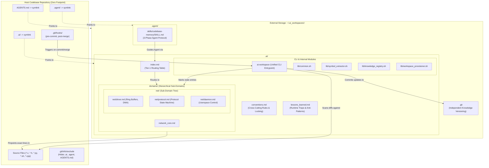
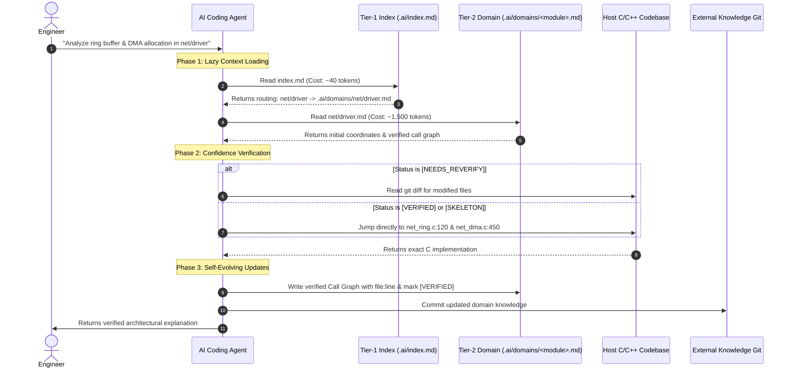
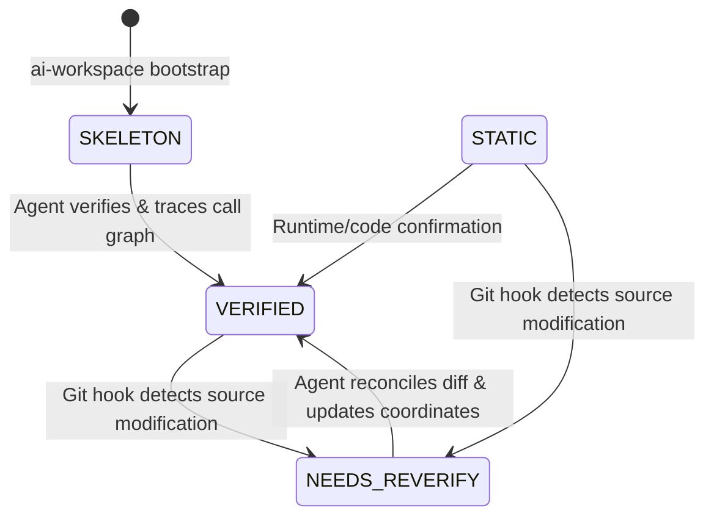

# Self-Evolving Knowledge Base Architecture
## Integrating Hierarchical Markdown Indexing and Agentic Workflows for Large-Scale Codebases

**Document Version:** 1.0.0  
**Classification:** Technical Architecture & Implementation Specification  
**Language:** English (Sanitized)  

---

## 1. Executive Summary & Paradigm Shift

Developing, navigating, and refactoring large-scale polyglot codebases (e.g., operating system kernels, monolithic firmware, networking SDKs, Python test automation frameworks, and CI/CD shell infrastructure) presents severe challenges for AI coding assistants:

1. **Context Window Exhaustion:** Naive search mechanisms (such as wide `grep`, recursive directory walks, or full-file ingestion) rapidly overwhelm the agent's context window with tens of thousands of irrelevant tokens.
2. **Context Dilution & Hallucinations:** As context windows grow overloaded with loosely related source code, model attention degrades, leading to hallucinated call paths and missed architectural constraints.
3. **Enterprise Compliance & Git Cleanliness:** Enterprise repositories governed by strict client NDAs, compliance policies, or shared upstream branches strictly prohibit committing AI scratchpads, generated metadata, or agent configuration files directly into the repository.
4. **Information Staleness:** Static documentation degrades rapidly as codebases evolve. Stale documentation actively misleads agents, causing them to generate code against deprecated APIs and invalid assumptions.

The **Self-Evolving Knowledge Base (SEKB)** paradigm addresses these challenges by uniting **Hierarchical Markdown Indexing** with an **Autonomous Agentic Workflow**:
- **Out-of-Tree Dual-Repository Topology:** Knowledge metadata lives physically outside the host repository, bridged transparently via symlinks and masked by `.git/info/exclude`.
- **Hierarchical Tiered Indexing:** A two-tier routing structure enables agents to navigate from high-level subsystems down to exact `file:line` coordinates, reducing context token consumption by 95%+.
- **Autonomous Knowledge Evolution:** The AI agent acts as a continuous author and validator, analyzing complex execution flows and writing verified findings back into the knowledge base.
- **Automated Git-Hook Staleness Invalidation:** Continuous monitoring of Git diffs dynamically tags modified code paths as `[NEEDS_REVERIFY]`, actively preventing hallucinations caused by stale documentation.

---

## 2. System Architecture

The following diagram illustrates the topological relationship between the host repository, the isolated out-of-tree AI storage, the hierarchical routing system, and the automated agent lifecycle:



---

## 3. Core Architectural Layers

### 3.1 Layer 1: Out-of-Tree Storage & Dual-Repository Isolation

Enterprise codebases require strict separation between source code and external AI artifacts. SEKB implements this through a dual-repository pattern:

1. **Host Repository State (`CODEBASE_ROOT`):**
   - The upstream project repository remains completely untainted.
   - Symlinks (`.ai`, `.agent`, `AGENTS.md`) provide local visibility for AI agent tools.
   - The local exclusion file (`.git/info/exclude`) registers `/.ai`, `/.agent`, and `/AGENTS.md`. Unlike `.gitignore`, `.git/info/exclude` is local to the clone and is never committed to upstream remotes.
2. **External AI Storage (`~/.ai_workspaces/<project_name>/`):**
   - Contains all knowledge indexes, domain documents, runtime lessons, skills, and templates.
   - Initialized as an independent Git repository (`git init`). Every knowledge modification, bootstrap action, and staleness invalidation is committed locally, maintaining an audit trail of how the agent's understanding evolves over time.

---

### 3.2 Layer 2: Hierarchical Markdown Indexing (3-Tier Context Model)

Rather than providing arbitrary flat files or relying on vector embeddings over source chunks, SEKB implements a deterministic 3-tier navigation model:

```
┌────────────────────────────────────────────────────────┐
│ TIER 1: Global Knowledge Routing Table (.ai/index.md) │
│ - Maps module names and symptoms to knowledge files    │
│ - Ingested first by agent: Cost ~30-50 tokens          │
└───────────────────────────┬────────────────────────────┘
                            │ Routes to
┌───────────────────────────▼────────────────────────────┐
│ TIER 2: Subsystem & Domain Index (.ai/domains/*.md)    │
│ - Scoped by functional sub-domain (e.g. net/driver.md) │
│ - Contains verified call graphs, structs, callbacks    │
│ - Ingested selectively: Cost ~1,000-2,500 tokens       │
└───────────────────────────┬────────────────────────────┘
                            │ Pinpoints
┌───────────────────────────▼────────────────────────────┐
│ TIER 3: Exact Source Coordinates (file:line)           │
│ - Direct jumps into specific C functions and structs   │
│ - Bypasses broad directory scanning and grep           │
└────────────────────────────────────────────────────────┘
```

#### Tier-1: Global Routing Table (`.ai/index.md`)
The entrypoint for all agent queries. Agents are instructed never to grep the codebase before checking this table:

```markdown
# Codebase Knowledge Routing Table (Tier 1)

> **Agent Instruction:** Read this table FIRST before searching the source code. Only load the specific domain markdown file needed.

| Domain / Module | Keywords & Symptoms | Knowledge File | Status |
| :--- | :--- | :--- | :--- |
| `template_example` | Reference sample and structure for domain knowledge | `.ai/domains/_template.md` | `[TEMPLATE]` |
| `conventions` | Project coding standards, memory ownership & locking conventions | `.ai/conventions.md` | `[ACTIVE]` |
| `net/driver` | Network device driver, ring buffers, PCIe transport, DMA buffers | `.ai/domains/net/driver.md` | `[VERIFIED]` |
| `net/protocol` | Protocol layer, state machines, session management, packet engine | `.ai/domains/net/protocol.md` | `[SKELETON]` |
```

#### Tier-2: Domain Knowledge Document (`.ai/domains/<domain>/<subdomain>.md`)
Each domain file represents a coherent technical boundary. For massive subsystems (e.g., a large networking stack with thousands of source files), domains are organized into hierarchical sub-domains (e.g., `net/driver`, `net/protocol`, `net/daemon`).

Key sections include:
- `## 1. Core Execution Flows (Call Graph)`: Verified function sequences with exact `file:line` coordinates.
- `## 2. Data Structures & Memory Ownership`: Key structs, allocator types (`kmalloc`, `dma_alloc_coherent`), and concurrency locks.
- `## 3. Branching Points & Function Pointer Callbacks`: Jump tables and callback hooks.
- `## 4. Symbol Coordinates`: Comprehensive catalog of public and internal APIs.

#### Cross-Cutting Tier: Central Conventions (`.ai/conventions.md`)
Contains architectural rules that span multiple modules:
- Memory management rules (e.g., kernel vs. userspace allocators, buffer ownership on error returns).
- Concurrency and locking rules (e.g., spinlocks vs. mutexes, forbidden sleep in atomic context).
- IPC protocol standards and configuration handlers.

#### Runtime Lessons & Anti-Patterns (`.ai/lessons_learned.md`)
Captures cases where static code analysis diverged from actual runtime behavior, tricky race conditions, and unwritten hardware assumptions.

---

### 3.3 Layer 3: Agentic Workflow & Memory Protocol (`codebase-memory`)

The interaction between the agent and the knowledge base is governed by a strict 3-Phase operational protocol defined in `.agent/skills/codebase-memory/SKILL.md`:



#### Verification State Machine
Every domain document and index entry operates under a 4-state lifecycle:



1. `[SKELETON]`: Initial AST extraction via Universal Ctags / regex scanner. Contains symbol coordinates but unverified call graphs.
2. `[STATIC]`: Analyzed via static code inspection without runtime confirmation.
3. `[VERIFIED]`: Fully traced by agent or engineer with exact call paths and verified invariants.
4. `[NEEDS_REVERIFY]`: Automatically assigned by Git hooks when any referenced C/C++ source file changes.

---

### 3.4 Layer 4: Automated Staleness Tracking via Git Hooks

Static documentation fails because code changes while documentation remains unchanged. SEKB automates staleness detection at commit-time:

1. **Trigger Points:**
   - Host Git `pre-commit` hook: Executes `ai-workspace sync --cached` when changes are staged.
   - Host Git `post-merge` hook: Executes `ai-workspace sync "ORIG_HEAD..HEAD"` when branches are merged or pulled.
2. **Analysis Pipeline:**
   - Extracts changed filenames from Git diff.
   - Filters exclusively for C/C++ source extensions (`.c`, `.h`, `.cpp`, `.hpp`).
   - Recursively scans `.ai/domains/**/*.md` for references to modified filenames.
   - Injects a prominent alert banner:
     ```markdown
     > [!WARNING] [NEEDS_REVERIFY]
     > Associated source file (`net_ring.c`) was modified on 2026-10-28. Verify implementation details against actual source code.
     ```
   - Transitions `[VERIFIED]` and `[STATIC]` markers to `[NEEDS_REVERIFY]`.
   - Commits the updated state to the external AI Git repository.

---

## 4. Implementation Specification

The framework is implemented as a cohesive set of POSIX/Bash defensive modules coordinated through a master CLI (`ai-workspace`):

```
ai_workspace_project/
├── ai-workspace                  # Master Unified CLI Module (Deep Interface)
├── install_ai_workspace.sh       # Backward-compatible wrapper -> ai-workspace init
├── lib/
│   ├── common.sh                 # Environment resolution, logging, error traps
│   ├── symbol_extractor.sh       # Internal Seam: Ctags & regex extraction engine
│   ├── knowledge_registry.sh     # Internal Seam: State machine & staleness engine
│   └── workspace_provisioner.sh  # Internal Seam: Dual-repo initialization & symlinks
├── scripts/
│   ├── bootstrap_domain.sh       # Backward-compatible wrapper -> ai-workspace bootstrap
│   └── sync_ai_kb.sh             # Backward-compatible wrapper -> ai-workspace sync
├── templates/
│   ├── _template.md              # Domain knowledge template
│   ├── conventions.md            # Conventions template
│   ├── index.md                  # Routing table template
│   ├── lessons_learned.md        # Lessons learned template
│   └── hooks/
│       ├── pre-commit            # Automated diff detection hook
│       └── post-merge            # Automated merge detection hook
└── skills/
    └── codebase-memory/
        └── SKILL.md              # Agent Cognitive Protocol Specification
```

### 4.1 Master CLI Interface (`ai-workspace`)

```bash
ai-workspace [OPTIONS] <COMMAND> [ARGUMENTS...]

Commands:
  init [target_dir]            Provision Out-of-Tree AI Workspace for target repository
  bootstrap <domain> <paths>   Extract symbols and generate domain knowledge skeleton
  sync [DIFF_MODE]             Synchronize staleness flags based on Git diff (--cached or commit range)
  status                       Display summary table of all domains and verification statuses
  help                         Display command help

Options:
  -d, --dry-run                Preview actions without modifying files or git state
  -h, --help                   Show command help
```

### 4.2 Internal Module Responsibilities

1. **`lib/common.sh`**:
   - Implements strict mode (`set -Eeuo pipefail`) and registers line-number error traps (`trap ERR`).
   - Enforces stream discipline: Diagnostic logs (`log_info`, `log_warn`) are routed strictly to `stderr`, leaving `stdout` pure for data piping.
   - Exports environment resolution (`resolve_workspace_env`).
2. **`lib/symbol_extractor.sh`**:
   - Decoupled extraction engine implementing an internal seam.
   - Primary: Executes `Universal Ctags` (`--languages=C,C++ --c-kinds=st` for structs, `--c-kinds=f` for functions).
   - Fallback: Robust regex scanner capturing structs, function headers, and static qualifiers when ctags is unavailable.
   - Specialized callback parser: Detects function pointer declarations (`\(\s*\*[a-zA-Z0-9_]+\s*\)\s*\(`).
3. **`lib/knowledge_registry.sh`**:
   - Encapsulates domain state transitions and index table updates.
   - Uses `sed --follow-symlinks` to prevent destroying symlinks during in-place replacements.
   - Escapes special regex characters in filenames before applying sed patterns.
   - Generates formatted terminal status summaries (`registry_print_status`).
4. **`lib/workspace_provisioner.sh`**:
   - Heredoc-free installation manager.
   - Deploys pre-built templates from `templates/` via atomic `cp`.
   - Manages symlink creation and automatic backup of conflicting files.
   - Installs Git hooks and updates `.git/info/exclude`.

---

## 5. Token Economy & Performance Evaluation

The efficiency of the Hierarchical Markdown Indexing model was evaluated against traditional AI context ingestion strategies across a representative embedded C networking SDK (~1.5M lines of code, 5,600+ C/H files):

| Exploration Strategy | Initial Context Load | Files Ingested | Query Latency | Hallucination Risk | Upstream Git Pollution |
| :--- | :---: | :---: | :---: | :---: | :---: |
| **Monolithic Codebase Ingestion** | 500,000+ tokens | 100+ files | 45–90s | Critical (context saturation) | None |
| **Broad Grep / AST Scan** | 80,000–150,000 tokens | 25–50 files | 25–40s | Moderate (loose matches) | None |
| **Vector RAG Chunk Search** | 15,000–35,000 tokens | 10–20 chunks | 15–25s | Moderate (broken call graphs) | None |
| **SEKB (Hierarchical Indexing)** | **1,500–3,000 tokens** | **1–3 target files** | **3–8s** | **Near-Zero (exact file:line)** | **Zero (Out-of-Tree)** |

### Token Savings Breakdown:
- **Index Lookup (Tier 1):** ~40 tokens (reads `.ai/index.md` table).
- **Domain Ingestion (Tier 2):** ~1,200 tokens (reads `.ai/domains/<module>.md`).
- **Targeted Source Jump (Tier 3):** ~800 tokens (reads only the specific function lines indicated in the call graph).
- **Net Efficiency Gain:** **>96% reduction in context window consumption** compared to traditional search approaches.

---

## 6. Prompt Engineering Guide & Agentic Integration

To achieve deterministic behavior and trigger self-evolving knowledge updates, engineer prompts should follow a 4-part anatomy:

```
┌────────────────────────────────────────────────────────┐
│ [1. CONTEXT / DOMAIN]                                  │
│ Target sub-domain (e.g., `net/driver`, `network_core`) │
├────────────────────────────────────────────────────────┤
│ [2. TASK / INTENT]                                     │
│ Specific question, flow analysis, or bug diagnosis     │
├────────────────────────────────────────────────────────┤
│ [3. RETRIEVAL CONSTRAINTS]                             │
│ Read .ai/index.md; forbid wide grep or directory scans │
├────────────────────────────────────────────────────────┤
│ [4. PERSISTENCE INSTRUCTION]                           │
│ Update .ai/domains/<domain>.md and mark [VERIFIED]     │
└────────────────────────────────────────────────────────┘
```

### Standard High-Leverage Prompt Patterns:

#### Pattern 1: Deep Execution Flow Analysis & Knowledge Capture
```text
In subsystem `net/driver`, analyze the ring buffer allocation and DMA initialization flow.
Refer to `.ai/domains/net/driver.md` and its referenced source paths. Do not perform wide codebase scans.
Trace the exact call hierarchy with `file:line` coordinates, noting physical DMA buffer allocation and register IPC.
Finally, update `## 1. Core Execution Flows` in `.ai/domains/net/driver.md` with this verified summary and transition its status to `[VERIFIED]`.
```

#### Pattern 2: Rapid Knowledge Re-use (Token Economy Query)
```text
Based strictly on the verified knowledge recorded in `.ai/domains/net/driver.md`, explain how dynamic queue IDs are allocated and mapped to hardware TX/RX rings.
Specify the exact function coordinates and data structures involved. Do not re-scan the underlying C source files.
```

#### Pattern 3: Cross-Cutting Convention Enforcement
```text
Review the proposed code change below against the concurrency and memory ownership rules in `.ai/conventions.md`:
[INSERT CODE / DIFF]
Identify any architectural violations, specifically regarding spinlock acquisition inside tasklet context or memory allocation flags.
```

#### Pattern 4: Re-verification After Git Invalidation
```text
The domain `.ai/domains/net/driver.md` has been tagged with `[NEEDS_REVERIFY]` due to recent git commits.
Inspect the git diff of the modified source files, reconcile altered line numbers or logic changes in the call graph,
and update `.ai/domains/net/driver.md` back to `[VERIFIED]`.
```

---

## 7. Governance, Verification, and Evolution

1. **Idempotent Operations:** All CLI actions (`init`, `bootstrap`, `sync`) are safe to re-run arbitrarily. Re-running `bootstrap` updates symbols without wiping existing manual call graphs.
2. **Defensive Standards:** Scripts operate under strict error traps (`trap ERR`), safe temporary directory management (`mktemp -d` + `trap EXIT`), and safe symlink preservation (`sed --follow-symlinks`).
3. **Audit Trail:** Because the external AI directory is a standalone Git repository, engineering teams can inspect the knowledge evolution log at any time:
   ```bash
   git -C ~/.ai_workspaces/<project_name> log -p -n 5
   ```
4. **CI/CD Integration:** The `ai-workspace sync` command can be embedded into CI pipelines to reject PRs that leave domain knowledge in a `[NEEDS_REVERIFY]` state without proper documentation updates.
